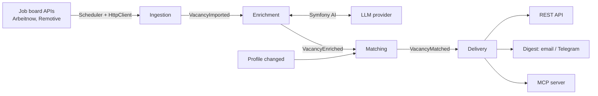

# Architecture

JobRadar is a modular monolith on Symfony 8.1. Four bounded contexts form a pipeline: they import vacancies from public job board APIs, extract structured attributes with an LLM, score vacancies against a candidate profile and deliver the results.

> **Current state (Module 1):** the Docker stack, the quality gates (`make check`, CI) and `GET /health` exist. The context directories are still empty: everything below is the target design that features are built against.

## Bounded contexts

| Context | Responsibility | Owns (PostgreSQL schema) | Publishes | Consumes |
| --- | --- | --- | --- | --- |
| Ingestion | Source adapters, raw responses, normalized vacancies, deduplication, import schedule | `ingestion`: Source, RawVacancy, Vacancy | `VacancyImported` | — |
| Enrichment | LLM attribute extraction, embeddings | `enrichment`: VacancyAttributes, VacancyEmbedding | `VacancyEnriched` | `VacancyImported` |
| Matching | Candidate profile, hard filters, 0–100 score, match explanation | `matching`: CandidateProfile, Match | `VacancyMatched` | `VacancyEnriched` |
| Delivery | REST API, candidate feedback, daily digest, MCP server | `delivery`: Feedback, Digest, read model for the API | — | `VacancyMatched` |

## Data flow

Import runs on a schedule. Each context reacts to the previous context's event and knows nothing about its internals. A message carries the vacancy ID and the data its consumer needs, so no context reads another context's tables. A profile change triggers rescoring inside Matching.

## Boundaries

- Contexts depend only on `src/Shared/Contract` (message classes) and `src/Shared/Kernel` (small framework-free primitives). Contract may use Kernel; Kernel depends on nothing. Enforced by `deptrac.contexts.yaml`.
- Each context owns one PostgreSQL schema. No queries and no foreign keys across schemas.
- Everything else under `App\` (`Kernel`, `Schedule`, `Shared/Infrastructure`, `Shared/UI`) is platform code. Contexts must not depend on it.

## Layers inside a context

Each context is `src/<Context>/{Domain,Application,Infrastructure,UI}`; tests mirror it under `tests/`.

| Layer | Contains | May depend on |
| --- | --- | --- |
| Domain | Entities, value objects, domain services. Plain PHP: no Symfony, no Doctrine, not even attributes | — |
| Application | Use cases, message handlers, ports (interfaces) | Domain |
| Infrastructure | Doctrine mapping and repositories, HTTP clients, LLM adapters | Domain, Application, framework |
| UI | Controllers, console commands, MCP tools | Application, framework |

Because Domain has no Doctrine attributes, the ORM mapping lives in Infrastructure. Today Deptrac enforces only the Domain rule (`deptrac.domain.yaml`); the full layer rules are planned for Module 1.

## Key technologies

| Concern | Choice | Decision |
| --- | --- | --- |
| Architecture style | Modular monolith with bounded contexts | [ADR 0002](adr/0002-modular-monolith.md) |
| Messaging | Symfony Messenger + RabbitMQ | [ADR 0003](adr/0003-messenger-rabbitmq.md) |
| Vector search | pgvector in PostgreSQL 17, `enrichment` schema | [ADR 0004](adr/0004-pgvector.md) |
| PHP runtime | `php:8.4-fpm` on Debian trixie, patch version pinned | [ADR 0005](adr/0005-debian-php-image.md) |
| Local networking | Published ports bound to `127.0.0.1` | [ADR 0006](adr/0006-localhost-ports.md) |
| Architecture checks | Deptrac with two configs: contexts and layers | [ADR 0007](adr/0007-two-deptrac-configs.md) |
| Cache, rate limits, locks | Redis via Symfony Cache, RateLimiter, Lock | — |
| LLM and embeddings | Symfony AI Platform; the provider (Anthropic, OpenAI, Ollama) is configuration | Phase D |

## Open questions

Not decided yet. If a task depends on one of these, stop and ask instead of choosing.

| Question | Decide in | Until then |
| --- | --- | --- |
| Event payloads: which vacancy fields each event carries, including what Delivery needs for its read model | Each context's spec; `VacancyImported` in the Ingestion spec (Module 2) | Events carry the vacancy ID plus only the fields named in the spec |
| Doctrine mapping format for framework-free entities: XML or PHP mapping in Infrastructure | Plan of the first entity (Module 2) | No mapping in Domain; no entities without a spec |
| Transactional outbox for "write to DB and publish event" | Module 7 | Handlers are idempotent; losing an event on a crash between commit and publish is an accepted risk |
| Embedding model and vector dimension | Phase D, before the first embedding | No `vector(N)` columns |
| Candidate profile format | Phase C, Matching spec | Do not model the profile ahead of the spec |
